<p align="center">
  
</p>

<p align="center">
  <a href="https://github.com/Atreu1s/terraria_rpg_mod">
    
  </a>
</p>

<p align="center">
  
  
  
  
</p>
<p align="center">
  
  
  
</p>

<p align="center">
  
</p>

<p align="center">
  
</p>

## ⚔️ Что это

**RPG-прогрессия для Terraria + Calamity.** Каждый убитый монстр даёт опыт, каждый уровень — очко стата. С 10 уровня выбираешь класс, а победы над ключевыми боссами открывают новые тиры древа пассивных навыков: **4 → 8 → 16 → 32**. После Лунного лорда собираешь эссенции и **пробуждаешь** свой класс.

> 🎯 Никаких активных способностей и масштабирования боссов — только пассивные и условные бонусы. Сложность по-прежнему регулирует сам Calamity.

| | |
| --- | --- |
| 📈 **Уровни** | Опыт по «силе» монстра, без потолка уровня |
| 💪 **6 статов** | Сила, Ловкость, Интеллект, Дух, Выносливость, Удача — с убывающей отдачей |
| 🛡️ **4 класса** | Воин, Стрелок, Маг, Призыватель + классовый прирост статов |
| 🌳 **Древо** | 60 пассивных узлов, на каждом тире — выбор одной из двух веток |
| ✨ **Пробуждение** | Финальная сила класса из эссенций боссов Calamity |
| 🔄 **Респек** | Предметы «Сброс статов» и «Сброс древа» |
| 🌐 **Мультиплеер** | Опыт считает сервер, прогресс хранится в персонаже |
| ⚙️ **Конфиг** | Все формулы опыта и статов настраиваются в игре |

<p align="center">
  
</p>

<p align="center">
  
</p>

Опыт зависит от базовой силы монстра, поэтому режим сложности не меняет его уровень:

```text
power      = 0.6 × √lifeMax + 0.8 × damage + 0.5 × defense
level      = power / 3
XP за моба = 2 × power^1.5 × разница уровней × события × множитель конфига
XP до след = 300 × L^2.5
```

- 🐌 **Разница уровней:** на 5 уровней выше монстра — без штрафа, дальше −10% за уровень (минимум 10%). За сильного монстра — до +50%.
- 🎃 **События** (луны, затмение, вторжения) дают ×0.5, чтобы не перепрыгивать этапы.
- 👑 **Боссы** — по таблице уровней (ваниль + Calamity), награда — половина опыта их уровня.
- 🚫 Статуи, городские NPC и мелкие существа опыта не дают.

| Открытие | Уровень | Условие |
| :---: | :---: | --- |
| 🎓 Класс | **10** | — |
| 🥉 Тир I | **25** | Стена плоти |
| 🥈 Тир II | **50** | Все три механических босса |
| 🥇 Тир III | **75** | Лунный лорд |

<p align="center">
  
</p>

<p align="center">
  
</p>

Убывающая отдача: `bonus(n) = X × n / (n + 100)` — 25 очков дают 20% от предела, 100 очков — 50%.

| | Стат | Основной эффект | Вторичный эффект |
| :---: | --- | --- | --- |
|  | **Сила** | Урон ближнего боя, до +60% | Скорость атаки ближнего боя, до +20% |
|  | **Ловкость** | Урон дальнего боя, до +60% | Скорость бега до +25%, экономия патронов до 25% |
|  | **Интеллект** | Урон магии, до +60% | +1 мана за очко (до +200), расход маны до −25% |
|  | **Дух** | Урон миньонов, до +60% | +1 слот на 30/80/150, хлысты до +30% |
|  | **Выносливость** | Макс. HP, до +200 | Снижение урона до 15%, +1 регенерации за 25 очков |
|  | **Удача** | Крит всех классов (и Разбойника), до +15% | `Player.luck`, до +0.3 |

<p align="center">
  
</p>

<p align="center">
  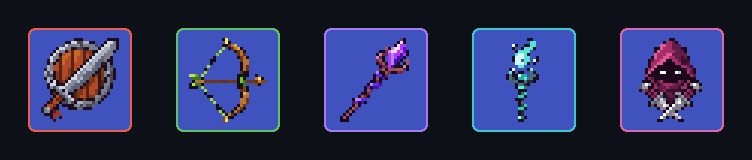
</p>

Класс определяет автоматический прирост статов за уровень: `floor(уровень × коэффициент)`. Поздний выбор класса не наказывается — прирост считается от текущего уровня.

| Класс | Бонус класса | Прирост за уровень |
| --- | --- | --- |
| 🔴 **Воин** | +5% урона ближнего боя, +20 HP | Сила 0.5 · Выносливость 0.35 |
| 🟢 **Стрелок** | +5% урона дальнего боя, +5% скорости | Ловкость 0.6 · Выносливость 0.25 |
| 🟣 **Маг** | +5% урона магии, +20 маны | Интеллект 0.6 · Дух 0.1 · Выносливость 0.15 |
| 🔵 **Призыватель** | +5% урона миньонов, +5% скорости хлыстов | Дух 0.55 · Интеллект 0.1 · Выносливость 0.2 |

<p align="center">
  
</p>

Тир I — роль с плюсом и минусом, тир II — механика, тир III — условный эффект. Выбрал ветку — соседняя закрывается. 👇 Пример выбранного пути для каждого класса (золотая рамка — пробуждённый узел):

<table>
  <tr>
    <td align="center"><b>🔴 Воин</b><br/></td>
    <td align="center"><b>🟢 Стрелок</b><br/>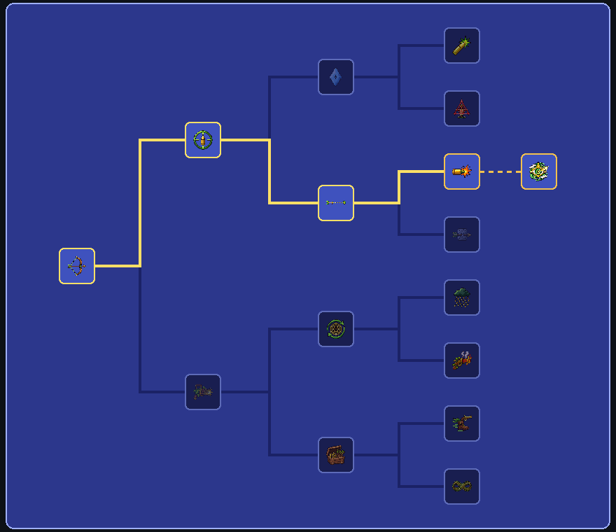</td>
  </tr>
  <tr>
    <td align="center"><b>🟣 Маг</b><br/></td>
    <td align="center"><b>🔵 Призыватель</b><br/>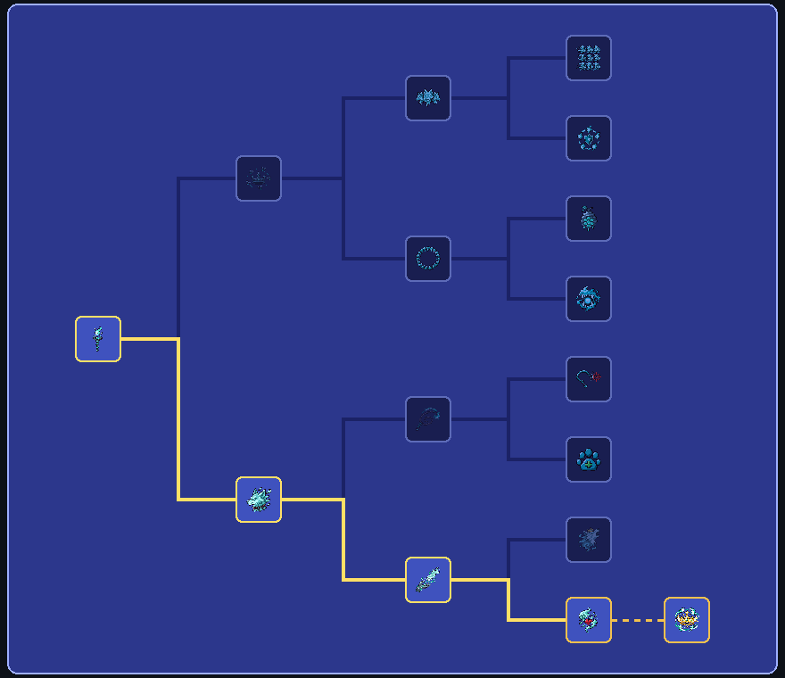</td>
  </tr>
</table>

<details>
<summary><b>🔴 Воин — все 15 узлов</b></summary>

| | Тир | Узел | Эффект |
| :---: | :---: | --- | --- |
| 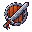 | 🎓 | **Воин** | +5% урона ближнего боя, +20 HP |
| 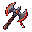 | I | **Берсерк** | +12% урона и +8% скорости атаки ближнего боя; −10% снижения урона |
|  | I | **Страж** | +10% HP, +8% снижения урона; −8% урона ближнего боя |
|  | II | **Кровавая ярость** | Урон растёт по мере потери HP, до +25% при HP ниже 30% |
|  | II | **Неистовство** | Каждый удар даёт стак +2% скорости атаки на 3 с, до 10 стаков |
| 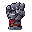 | II | **Железная плоть** | +1% урона ближнего боя за каждые 5 защиты, до +25% |
|  | II | **Возмездие** | После получения урона следующий удар в течение 3 с наносит +30% |
|  | III | **Одержимый** | При HP ниже 25%: вампиризм 3% нанесённого урона, не больше 10 HP/с |
|  | III | **Несокрушимый** | Раз в 5 минут смертельный удар оставляет 1 HP и даёт 3 с неуязвимости |
|  | III | **Вихрь** | На 10 стаках: +15% урона и +15% скорости передвижения |
|  | III | **Железный ритм** | Стаки держатся 6 с, максимум 6; каждый стак ещё +2% урона |
|  | III | **Колосс** | +15% макс. HP; каждые 100 макс. HP дают +2% снижения урона, до +10% |
|  | III | **Щит воли** | 8 с без получения урона создают щит на 15% макс. HP; иммунитет к отбрасыванию |
|  | III | **Око за око** | Удар Возмездия лечит на 5% нанесённого урона |
|  | III | **Ответный удар** | При получении урона враги в 10 блоках получают 100% этого урона, перезарядка 2 с |

</details>

<details>
<summary><b>🟢 Стрелок — все 15 узлов</b></summary>

| | Тир | Узел | Эффект |
| :---: | :---: | --- | --- |
|  | 🎓 | **Стрелок** | +5% урона дальнего боя, +5% скорости передвижения |
|  | I | **Снайпер** | +10% урона дальнего боя, +8% крита; −12% скорости атаки |
| 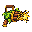 | I | **Пулемётчик** | +15% скорости атаки дальнего боя; −6% крита, −5% урона |
|  | II | **Хладнокровие** | Стоя на месте 1 с: +15% крита и +10% урона |
| 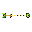 | II | **Дальнобойность** | Урон растёт с расстоянием до цели, до +20% на 40+ блоках |
|  | II | **Раскрутка** | Непрерывная стрельба: +2% скорости атаки в секунду, до +20% |
|  | II | **Запасливость** | +20% шанс не потратить патрон, +8% скорости передвижения |
|  | III | **Смертельный выстрел** | Криты наносят ×2,5 урона вместо ×2 |
|  | III | **Метка охотника** | Попадание помечает цель на 5 с: она получает +10% урона от всех |
| 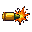 | III | **Разрывные снаряды** | Криты взрываются: 35% урона по врагам в радиусе 3 блоков |
|  | III | **Бронебойность** | Выстрелы игнорируют 20 защиты врага |
|  | III | **Свинцовый ливень** | На максимальной раскрутке 20% шанс дополнительного снаряда |
|  | III | **Перегрев** | На максимальной раскрутке снаряды поджигают цель |
| 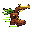 | III | **Бег и стрельба** | В движении +10% урона дальнего боя |
|  | III | **Бездонный магазин** | Ещё +30% шанс не потратить патрон; при HP выше 80% +8% урона |

</details>

<details>
<summary><b>🟣 Маг — все 15 узлов</b></summary>

| | Тир | Узел | Эффект |
| :---: | :---: | --- | --- |
|  | 🎓 | **Маг** | +5% урона магии, +20 маны |
|  | I | **Арканист** | +14% урона магии; −15% макс. маны |
|  | I | **Мистик** | −20% расхода маны, +60 маны, быстрее регенерация; −8% урона магии |
|  | II | **Перегрузка** | +1% урона магии за каждый 1% недостающей маны, до +25% |
|  | II | **Стихийная мощь** | 15% шанс наложить огонь, мороз или яд |
|  | II | **Поток** | При мане выше 70%: +10% урона и +8% скорости атаки магии |
|  | II | **Медитация** | Стоя на месте: регенерация маны ×2 и +2 HP/с |
|  | III | **Магия крови** | При нехватке маны заклинание тратит HP: 2 HP за 1 ману |
|  | III | **Резонанс** | Каждое 5-е попадание магией наносит двойной урон |
|  | III | **Катализ** | +15% урона по врагам под любым дебаффом |
|  | III | **Цепная реакция** | Убийство врага под дебаффом переносит дебаффы на врагов в 10 блоках |
|  | III | **Мана-щит** | 20% полученного урона снимается с маны вместо HP |
|  | III | **Переполнение** | Регенерация маны не останавливается при атаке; ещё −10% расхода |
|  | III | **Просветление** | После 3 с на месте следующее заклинание наносит +40% |
|  | III | **Мана-кровь** | Каждые 100 потраченной маны восстанавливают 10 HP |

</details>

<details>
<summary><b>🔵 Призыватель — все 15 узлов</b></summary>

| | Тир | Узел | Эффект |
| :---: | :---: | --- | --- |
|  | 🎓 | **Призыватель** | +5% урона миньонов, +5% скорости хлыстов |
|  | I | **Повелитель роя** | +1 слот миньонов; −8% урона миньонов |
| 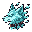 | I | **Дрессировщик** | +14% урона и отбрасывания миньонов; −10% HP |
|  | II | **Стая** | +2% урона миньонов за каждого активного миньона |
|  | II | **Тысяча укусов** | Попадание миньона даёт стак на враге (до 10): +1% урона миньонов по цели за стак, стаки держатся 3 с |
|  | II | **Мастер хлыста** | +20% скорости хлыстов; удар хлыстом даёт миньонам +10% урона на 5 с |
| 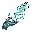 | II | **Связь** | Пока есть хотя бы 1 миньон: +12% снижения урона |
| 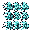 | III | **Легион** | +1 слот миньонов |
|  | III | **Единство** | При 5+ миньонах: +10% снижения урона игроку |
|  | III | **Улей** | На 10 стаках цель получает +10% урона от всех источников |
|  | III | **Пожиратель** | Убийство цели с 5+ стаками лечит на 5 HP и даёт +5% урона миньонов на 5 с, до 3 раз |
|  | III | **Команда «Фас»** | Цель, отмеченная хлыстом, получает +15% урона от миньонов |
|  | III | **Забота о стае** | Удар хлыстом лечит 1 HP за каждого миньона, не чаще раза в секунду |
|  | III | **Альфа** | Если призван только один тип миньонов, +20% их урона |
|  | III | **Жертва** | Раз в 3 минуты смертельный удар убирает всех миньонов и оставляет 1 HP |

</details>

<p align="center">
  
</p>

<p align="center">
  
</p>

1. 🌙 **Подсказка.** После Лунного лорда в древе появляется слот «???»: *«Сила спит в сердцах тех, кто пал после Луны»*.
2. 💀 **Эссенции.** Providence, Ceaseless Void, Storm Weaver, Signus и Polterghast роняют личную Эссенцию пробуждения. Нужны 3 с разных боссов.
3. ⚒️ **Крафт.** Камень = 3 эссенции + 10 Divine Geode + 3 Armored Shell + 3 Dark Plasma + 3 Twisting Nether на Древнем манипуляторе.
4. ✨ **Пробуждение.** Требует узел тира III. Работает уже на Devourer of Gods, Yharon, Exo Mechs и Supreme Calamitas.

| | Пробуждение | Эффект | Надбавка подкласса |
| :---: | --- | --- | --- |
|  | **Аватар войны** | Удары копят Пыл; на полной шкале 8 с: +30% урона, +20% скорости атаки | Берсерк: вампиризм 2% · Страж: +15% снижения урона |
|  | **Око бури** | Каждый 10-й выстрел — самонаводящийся снаряд на 300% | Снайпер: каждый 6-й · Пулемётчик: 3 снаряда по 100% |
|  | **Архимаг** | Мана кончилась — 5 с бесконечной маны, перезарядка 45 с | Арканист: +25% урона · Мистик: лечит 20% HP |
|  | **Владыка духов** | +1 слот; миньоны критуют с шансом крита игрока | Повелитель роя: ещё +1 слот · Дрессировщик: криты ×2.5 |

<p align="center">
  
</p>

<p align="center">
  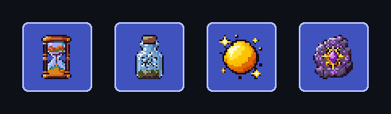
</p>

| | Предмет | Рецепт | Что делает |
| :---: | --- | --- | --- |
|  | **Сброс статов** | 1 Дерево + 1 Упавшая звезда · Верстак | Возвращает все вложенные очки статов |
|  | **Сброс древа** | 1 Дерево + 2 Упавшие звезды · Верстак | Сбрасывает класс, узлы и пробуждение (Камень возвращается) |
|  | **Эссенция пробуждения** | Дроп с 5 боссов Calamity | Материал для Камня |
|  | **Камень пробуждения** | См. выше · Древний манипулятор | Пробуждает класс |

<p align="center">
  
</p>

## 🚀 Установка

1. Установи [tModLoader](https://store.steampowered.com/app/1281930/tModLoader/) (1.4.4). Calamity — по желанию: без него мод работает, только без пробуждения.
2. Склонируй репозиторий в папку `ModSources`:
   ```bash
   cd "Documents/My Games/Terraria/tModLoader/ModSources"
   git clone https://github.com/Atreu1s/terraria_rpg_mod.git RPGMod
   ```
3. В игре: **Workshop → Develop Mods → RPGMod → Build + Reload**.
4. Открой инвентарь и нажми кнопку **«Статус»** — откроется окно персонажа.

> 💡 Позицию кнопки «Статус» можно поменять в конфиге **«Интерфейс RPG»**, а клавишу открытия окна — в настройках управления.

## 🛠️ Отладка

Включи **«Отладочные команды»** в конфиге мода, и в чате станет доступна команда `/rpg`:

| Команда | Что делает |
| --- | --- |
| `/rpg` | Показать уровень, опыт, класс и флаги боссов |
| `/rpg level 50` | Установить уровень |
| `/rpg xp 10000` | Начислить опыт (с повышением уровня) |
| `/rpg downed wof` · `mech` · `moonlord` · `all` · `none` | Выставить флаги боссов мира |
| `/rpg reset` | Сбросить прогресс персонажа |

## 🗂️ Структура

```text
RPGMod/
├── Common/
│   ├── Players/        RPGPlayer (уровень, статы, древо, сохранение, сеть) + узлы по классам
│   ├── NPCs/           начисление опыта, дроп эссенций
│   ├── Data/           реестр 60 узлов, уровни боссов, прирост классов
│   ├── Config/         серверный и клиентский конфиг
│   └── StatMath.cs     все формулы
├── Content/Items/      сбросы, эссенция, камень
├── UI/                 HUD уровня, окно статов, панель древа
├── Assets/             иконки узлов и статов (32×32)
├── Localization/       ru-RU + en-US
└── docs/               дизайн-документ, UI-спецификация, макеты
```

📖 Полные механики — в [docs/DESIGN.md](docs/DESIGN.md), внешний вид — в [docs/UI_SPEC.md](docs/UI_SPEC.md).

## 🤖 Как сделан

[](https://claude.com/claude-code)
[](https://openai.com/codex)
[](https://github.com/tModLoader/tModLoader)

Мод собран двумя ИИ-агентами параллельно по общему дизайн-документу:

- 🧠 **Claude Code** — ядро: опыт, статы, классы, узлы Воина и Стрелка, сеть, сохранение, весь интерфейс.
- 🎨 **Codex** — 74 пиксельные иконки, узлы Мага и Призывателя, предметы сброса, пробуждение.

<p align="center">
  
</p>

<p align="center">
  
</p>
