<p align="center">
  
</p>

# Terraria RPG Mod 2.0

<p align="center">
  
  
  
  
</p>

<p align="center">
  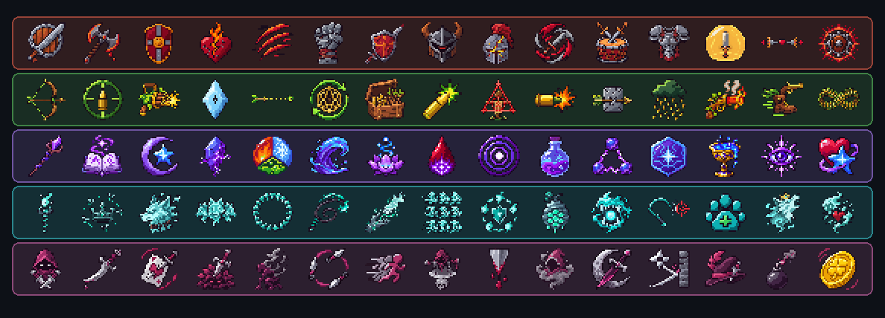
</p>

Earn experience from enemies, spend points on stats, and choose a class at level 10. Boss milestones unlock three tiers of passive skills. Enable Calamity for the Rogue class, the Cunning stat, and post-Moon Lord class awakenings.

## What's new in 2.0

| Feature | Terraria + RPG Mod | With Calamity Mod enabled |
| --- | --- | --- |
| Classes | Warrior, Ranger, Mage, Summoner | All four plus **Rogue** |
| Stats | 6 | 7 with **Cunning** |
| Passive skill nodes | 60 | 75, including Rogue's 15-node tree |
| Class awakenings | Hidden | Available for all five classes |
| Awakening materials | Hidden | Awakening Essence and Awakening Stone |

- **Rogue** specializes as either an **Assassin**, with powerful opening hits and critical strikes, or a **Trickster**, with stacking attack speed and evasion.
- **In the Shadows** is a Rogue skill state. With the Shadow node selected, it becomes ready after two seconds without attacking. An icon appears beside the XP bar and the next eligible Rogue hit spends the effect. Calamity's stealth mechanic continues to work alongside it.
- **Lord of Shadows** adds a fan of homing daggers, with different bonuses for Assassin and Trickster.
- **17 new pixel-art icons** cover Rogue's 15 nodes, Cunning, and Lord of Shadows. Both English and Russian include the new content.

Version 1 characters carry over to 2.0. Disabling Calamity hides a saved Rogue tree and suspends its class effects and awakenings. The class, selected skills, and awakening return when Calamity is enabled again. Points spent on Cunning return to the unspent pool when the character loads without Calamity. Resetting an awakened tree in that mode defers the Awakening Stone refund until the character next enters with Calamity.

## Levels and experience

Enemy XP is based on base enemy stats. The server calculates XP in multiplayer, and progress is saved with the character. The default XP settings are:

```text
Enemy power     = 0.6 × sqrt(max life) + 0.8 × damage + 0.5 × defense
Enemy level     = max(1, round(enemy power / 3))
Enemy base XP   = 2 × enemy power ^ 1.5
XP to next level = 300 × current level ^ 2.5
```

The level-difference, event, and server XP multipliers apply to enemy base XP. By default, enemies more than five levels below you give 10% less XP per additional level, down to 10% of base XP. Stronger enemies grant up to 50% extra XP. Events such as moons, eclipses, and invasions halve XP. Bosses use a separate level table and reward up to half the XP needed at their assigned level before contribution and server modifiers. Statue spawns, town NPCs, and critters grant no XP.

| Milestone | Character level | Boss milestone |
| --- | ---: | --- |
| Choose a class | 10 | None |
| Tier I | 25 | Wall of Flesh |
| Tier II | 50 | All three mechanical bosses |
| Tier III | 75 | Moon Lord |

## Stats

<p align="center">
  
</p>

Each level grants a stat point by default. Most bonuses have diminishing returns. The formula is `maximum × points / (points + 100)`, so 25 points give 20% of the listed maximum and 100 points give 50%.

| Icon | Stat | Primary effect | Secondary effect |
| :---: | --- | --- | --- |
|  | **Strength** | Up to +60% melee damage | Up to +20% melee attack speed |
|  | **Agility** | Up to +60% ranged damage | Up to +25% movement speed and 25% ammo conservation |
|  | **Intellect** | Up to +60% magic damage | +1 mana per point, up to +200, and up to 25% less mana cost |
|  | **Spirit** | Up to +60% minion damage | +1 minion slot at 30, 80, and 150 points, and up to +30% whip speed and range |
|  | **Cunning** (Calamity) | Up to +60% Rogue damage | Up to +20% Rogue attack speed |
|  | **Vitality** | Up to +200 max life | Up to 15% damage reduction and +1 life regeneration per 25 points |
|  | **Luck** | Up to +15 percentage points of critical strike chance across classes | Up to +0.3 Terraria luck |

## Classes

<p align="center">
  
</p>

Classes grant a starting bonus and automatic stat growth. Growth is calculated from the current level and rounded down, so choosing a class later gives you the growth for levels you already earned.

| Icon | Class | Starting bonus | Growth per level |
| :---: | --- | --- | --- |
|  | **Warrior** | +5% melee damage, +20 max life | Strength 0.50 · Vitality 0.35 |
|  | **Ranger** | +5% ranged damage, +5% movement speed | Agility 0.60 · Vitality 0.25 |
|  | **Mage** | +5% magic damage, +20 max mana | Intellect 0.60 · Spirit 0.10 · Vitality 0.15 |
|  | **Summoner** | +5% minion damage, +5% whip speed | Spirit 0.55 · Intellect 0.10 · Vitality 0.20 |
|  | **Rogue** (Calamity) | +5% Rogue damage, +5 percentage points of Rogue critical strike chance | Cunning 0.55 · Agility 0.10 · Vitality 0.20 |

## Skill trees

Each class has 15 nodes arranged as **1 → 2 → 4 → 8**. Pick a specialization in Tier I, a defining mechanic in Tier II, and a finishing passive in Tier III. Choosing a node closes its sibling branch until you reset the tree. The illustrations highlight sample builds. Gold marks the awakened node and class awakening.

<table>
  <tr>
    <td align="center" width="50%"><b>Warrior</b><br/>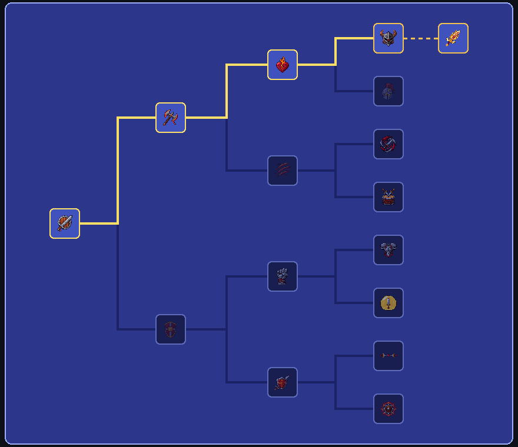</td>
    <td align="center" width="50%"><b>Ranger</b><br/></td>
  </tr>
  <tr>
    <td align="center"><b>Mage</b><br/>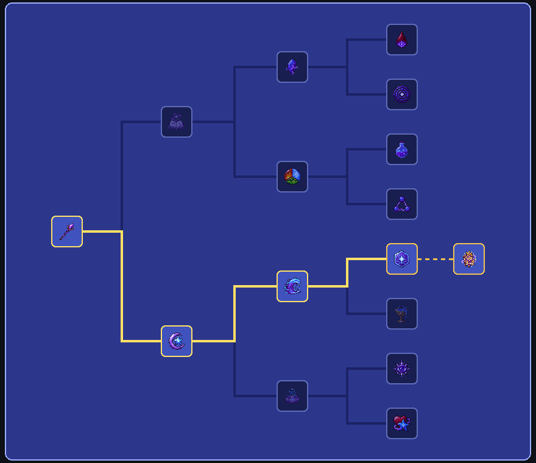</td>
    <td align="center"><b>Summoner</b><br/></td>
  </tr>
  <tr>
    <td align="center"><b>Rogue · Assassin</b> (Calamity)<br/>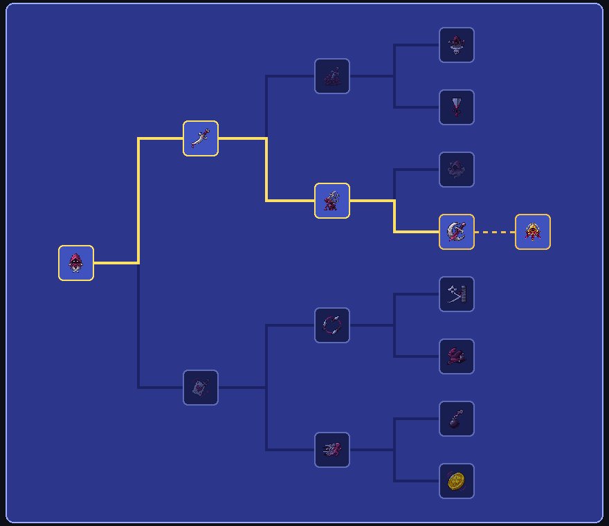</td>
    <td align="center"><b>Rogue · Trickster</b> (Calamity)<br/>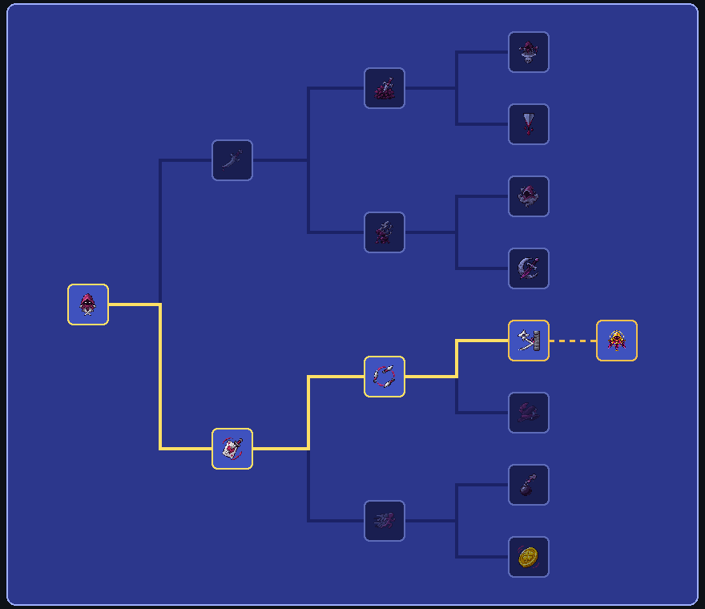</td>
  </tr>
</table>

<details>
<summary><b>Warrior — all 15 nodes</b></summary>

| Icon | Tier | Node | Requires | Effect |
| :---: | :---: | --- | --- | --- |
|  | Class | **Warrior** | — | +5% melee damage, +20 max life |
|  | I | **Berserker** | Warrior | +12% melee damage and +8% melee speed; −10% damage reduction |
|  | I | **Guardian** | Warrior | +10% max life, +8% damage reduction; −8% melee damage |
|  | II | **Blood Rage** | Berserker | Damage grows as you lose life, up to +25% below 30% life |
|  | II | **Frenzy** | Berserker | Each hit grants a stack of +2% attack speed for 3 s, up to 10 stacks |
|  | II | **Iron Flesh** | Guardian | +1% melee damage per 5 defense, up to +25% |
|  | II | **Retribution** | Guardian | After taking damage, your next hit within 3 s deals +30% |
|  | III | **Possessed** | Blood Rage | Below 25% life: 3% lifesteal, at most 10 HP/s |
| 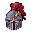 | III | **Unbreakable** | Blood Rage | Once per 5 minutes a lethal hit leaves you at 1 HP with 3 s of invulnerability |
|  | III | **Whirlwind** | Frenzy | At 10 stacks: +15% damage and +15% move speed |
|  | III | **Iron Rhythm** | Frenzy | Stacks last 6 s, max 6; each stack also gives +2% damage |
|  | III | **Colossus** | Iron Flesh | +15% max life; every 100 max life gives +2% damage reduction, up to +10% |
|  | III | **Shield of Will** | Iron Flesh | 8 s without taking damage creates a shield for 15% max life; knockback immunity |
| 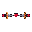 | III | **Eye for an Eye** | Retribution | Retribution hits heal for 5% of damage dealt |
|  | III | **Counterstrike** | Retribution | When hit, enemies within 10 tiles take 100% of that damage, 2 s cooldown |

</details>

<details>
<summary><b>Ranger — all 15 nodes</b></summary>

| Icon | Tier | Node | Requires | Effect |
| :---: | :---: | --- | --- | --- |
|  | Class | **Ranger** | — | +5% ranged damage, +5% move speed |
|  | I | **Sniper** | Ranger | +10% ranged damage, +8% crit; −12% attack speed |
|  | I | **Gunner** | Ranger | +15% ranged attack speed; −6% crit, −5% damage |
|  | II | **Cold Blood** | Sniper | Standing still for 1 s: +15% crit and +10% damage |
|  | II | **Long Range** | Sniper | Damage grows with distance, up to +20% at 40+ tiles |
|  | II | **Spin-Up** | Gunner | Continuous fire: +2% attack speed per second, up to +20% |
|  | II | **Quartermaster** | Gunner | +20% chance not to consume ammo, +8% move speed |
|  | III | **Deadshot** | Cold Blood | Crits deal ×2.5 damage instead of ×2 |
|  | III | **Hunter's Mark** | Cold Blood | Hits mark the target for 5 s: it takes +10% damage from all sources |
|  | III | **Explosive Rounds** | Long Range | Crits explode: 35% damage to enemies within 3 tiles |
| 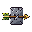 | III | **Armor Breaker** | Long Range | Shots ignore 20 enemy defense |
|  | III | **Lead Rain** | Spin-Up | At max spin-up, 20% chance for an extra projectile |
| 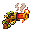 | III | **Overheat** | Spin-Up | At max spin-up, projectiles set the target on fire |
|  | III | **Run and Gun** | Quartermaster | While moving: +10% ranged damage |
|  | III | **Bottomless Magazine** | Quartermaster | +30% more chance not to consume ammo; above 80% life +8% damage |

</details>

<details>
<summary><b>Mage — all 15 nodes</b></summary>

| Icon | Tier | Node | Requires | Effect |
| :---: | :---: | --- | --- | --- |
|  | Class | **Mage** | — | +5% magic damage, +20 max mana |
|  | I | **Arcanist** | Mage | +14% magic damage; −15% max mana |
|  | I | **Mystic** | Mage | −20% mana cost, +60 max mana, faster mana regeneration; −8% magic damage |
|  | II | **Overload** | Arcanist | +1% magic damage per 1% missing mana, up to +25% |
|  | II | **Elemental Might** | Arcanist | 15% chance to inflict fire, frost or poison |
|  | II | **Flow** | Mystic | Above 70% mana: +10% damage and +8% magic attack speed |
|  | II | **Meditation** | Mystic | Standing still: ×2 mana regeneration and +2 HP/s |
|  | III | **Blood Magic** | Overload | When out of mana, spells cost life: 2 HP per 1 mana |
|  | III | **Resonance** | Overload | Every 5th magic hit deals double damage |
|  | III | **Catalyst** | Elemental Might | +15% damage to enemies with any debuff |
|  | III | **Chain Reaction** | Elemental Might | Killing a debuffed enemy spreads its debuffs to enemies within 10 tiles |
|  | III | **Mana Shield** | Flow | 20% of damage taken is drained from mana instead of life |
|  | III | **Overflow** | Flow | Mana regeneration does not stop while attacking; another −10% mana cost |
|  | III | **Enlightenment** | Meditation | After 3 s standing still, your next spell deals +40% |
|  | III | **Mana Blood** | Meditation | Every 100 mana spent restores 10 HP |

</details>

<details>
<summary><b>Summoner — all 15 nodes</b></summary>

| Icon | Tier | Node | Requires | Effect |
| :---: | :---: | --- | --- | --- |
|  | Class | **Summoner** | — | +5% minion damage, +5% whip speed |
|  | I | **Swarm Lord** | Summoner | +1 minion slot; −8% minion damage |
|  | I | **Beastmaster** | Summoner | +14% minion damage and knockback; −10% max life |
|  | II | **Pack** | Swarm Lord | +2% minion damage per active minion |
|  | II | **Thousand Bites** | Swarm Lord | Minion hits stack on the enemy (up to 10): +1% minion damage to it per stack, stacks last 3 s |
|  | II | **Whip Master** | Beastmaster | +20% whip speed; whip hits give minions +10% damage for 5 s |
|  | II | **Bond** | Beastmaster | While you have at least 1 minion: +12% damage reduction |
|  | III | **Legion** | Pack | +1 minion slot |
|  | III | **Unity** | Pack | With 5+ minions: +10% damage reduction |
|  | III | **Hive** | Thousand Bites | At 10 stacks the target takes +10% damage from all sources |
|  | III | **Devourer** | Thousand Bites | Killing a target with 5+ stacks heals 5 HP and gives +5% minion damage for 5 s, up to 3 times |
|  | III | **Sic 'Em** | Whip Master | A whip-tagged target takes +15% damage from minions |
|  | III | **Pack Care** | Whip Master | Whip hits heal 1 HP per minion, at most once per second |
| 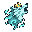 | III | **Alpha** | Bond | If only one minion type is summoned, +20% damage for them |
|  | III | **Sacrifice** | Bond | Once per 3 minutes a lethal hit dismisses all minions and leaves you at 1 HP |

</details>

<details>
<summary><b>Rogue (Calamity) — all 15 nodes</b></summary>

| Icon | Tier | Node | Requires | Effect |
| :---: | :---: | --- | --- | --- |
|  | Class | **Rogue** | — | +5% rogue damage, +5% rogue critical strike chance |
|  | I | **Assassin** | Rogue | +12% rogue damage, +6% rogue critical strike chance; −10% max life |
|  | I | **Trickster** | Rogue | +15% rogue attack speed, +10% movement speed; −6% rogue damage |
| 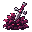 | II | **Ambush** | Assassin | Your first rogue hit against an enemy at full life deals +50% damage |
| 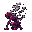 | II | **Shadow** | Assassin | Unlocks In the Shadows: a hit from the shadows deals +25% damage and always critically strikes |
|  | II | **Juggler** | Trickster | Rogue hits grant a stack of +3% rogue attack speed for 3 s, up to 5 stacks |
|  | II | **Evasion** | Trickster | 10% chance to completely evade a hit; 5 s cooldown |
|  | III | **Executioner** | Ambush | +30% rogue damage against enemies below 30% life |
|  | III | **First Blood** | Ambush | Ambush inflicts bleeding: 10% of hit damage per second for 5 s |
|  | III | **Vanish** | Shadow | Killing an enemy immediately restores In the Shadows |
|  | III | **Dusk Blade** | Shadow | Hits from the shadows: critical strikes deal ×2.5 instead of ×2 damage and ignore 15 defense |
| 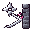 | III | **Ricochet** | Juggler | At 5 stacks, hits release a shard at the nearest other enemy within 15 tiles for 40% damage, at most 3 times per second |
|  | III | **Bravado** | Juggler | At 5 stacks: +15% movement speed and +10% rogue critical strike chance |
| 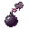 | III | **Smoke Bomb** | Evasion | After evading: 1.5 s of invulnerability and +40% damage on your next rogue hit |
|  | III | **Lucky Break** | Evasion | +1% evasion chance per 20 Luck, up to +10%; evading heals 5% max life |

</details>

## Class awakening

<p align="center">
  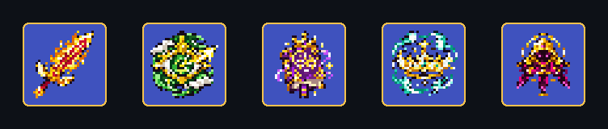
</p>

Awakening requires Calamity and a selected Tier III skill.

1. Defeat Moon Lord to reveal the awakening slot in the skill tree.
2. Collect personal Awakening Essences from at least three different bosses. Eligible bosses are Providence, Ceaseless Void, Storm Weaver, Signus, and Polterghast.
3. At an Ancient Manipulator, combine **3 Awakening Essences**, **10 Divine Geodes**, **3 Armored Shells**, **3 Dark Plasma**, and **3 Twisting Nether** into an Awakening Stone.
4. Use the stone to awaken the selected class.

| Icon | Class | Awakening | Effect | Specialization bonus |
| :---: | --- | --- | --- | --- |
|  | Warrior | **Avatar of War** | Hits build Fervor; when full, 8 s of +30% damage and +20% attack speed | Berserker: 2% lifesteal · Guardian: +15% damage reduction |
|  | Ranger | **Eye of the Storm** | Every 10th shot fires a homing projectile for 300% damage | Sniper: every 6th · Gunner: 3 projectiles for 100% |
|  | Mage | **Archmage** | When mana runs out, 5 s of infinite mana; 45 s cooldown | Arcanist: +25% damage meanwhile · Mystic: heals 20% life |
|  | Summoner | **Lord of Spirits** | +1 minion slot; minions crit with your crit chance | Swarm Lord: +1 more slot · Beastmaster: minion crits ×2.5 |
|  | Rogue | **Lord of Shadows** | Every 8th rogue hit releases a fan of 3 homing shadow daggers for 60% damage each | Assassin: daggers for 100% damage · Trickster: every 5th hit |

Rogue daggers created by Lord of Shadows or Ricochet do not feed the awakening counter or trigger another round of Rogue skill effects.

## Items and respec

<p align="center">
  
</p>

| Icon | Item | Source | Effect |
| :---: | --- | --- | --- |
|  | **Stat Reset** | 1 Wood + 1 Fallen Star at a Work Bench | Refunds manually allocated stat points. |
|  | **Tree Reset** | 1 Wood + 2 Fallen Stars at a Work Bench | Resets the class, selected skills, and awakening. Returns the Awakening Stone immediately if Calamity is loaded, or on the next entry with Calamity. |
|  | **Awakening Essence** | Personal drop from eligible Calamity bosses | Material for the Awakening Stone. |
|  | **Awakening Stone** | Ancient Manipulator recipe above | Awakens the selected class. |

## Installation

1. Install [tModLoader for Terraria 1.4.4](https://store.steampowered.com/app/1281930/tModLoader/). Enable Calamity Mod if you want Rogue, Cunning, and class awakening.
2. Clone this repository into the tModLoader `ModSources` folder, usually under `Documents/My Games/Terraria/tModLoader`.

   ```bash
   git clone https://github.com/Atreu1s/terraria_rpg_mod.git RPGMod
   ```

3. In tModLoader, go to **Workshop → Develop Mods → RPGMod → Build + Reload**.
4. Open your inventory and select **Status** to see the character panel. The optional **Character window** keybind can be set in Controls.

The server config controls XP, stat scaling, unlock levels, and Rogue balance. Client options cover the character UI and HUD.

## Debug commands

Enable **Debug commands** in the server-side mod config before using these in chat.

| Command | Effect |
| --- | --- |
| `/rpg` or `/rpg points` | Show character progression and boss flags. |
| `/rpg mode` | Show whether Calamity is loaded and Rogue is available. |
| `/rpg level 75` | Set the character level. |
| `/rpg xp 10000` | Add experience. |
| `/rpg downed wof`, `mech`, `moonlord`, `all`, or `none` | Set the world's progression flags. |
| `/rpg reset` | Reset the character's RPG progression. |

## Project and documentation

- `Common/` contains progression, combat effects, persistence, networking, and Calamity compatibility.
- `Content/`, `UI/`, and `Assets/` contain in-game items, projectiles, screens, and sprites.
- `Localization/` contains the English and Russian game text.
- The [game design](docs/DESIGN.md), [2.0 design](docs/v2/DESIGN_V2.md), [UI specification](docs/UI_SPEC.md), and [3.0 roadmap](docs/ROADMAP_V3.md) contain the design details.
- To regenerate this README and its illustrations, run `npm ci --prefix tools/icons` and `node docs/readme/build.js` from the repository root. The skill and awakening tables use the English game localization and the skill registry.

Built by [Atreu1s](https://github.com/Atreu1s) with Claude Code and Codex.
